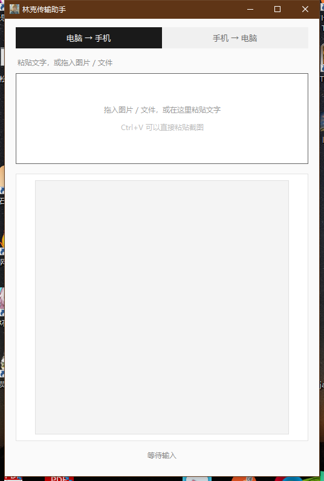
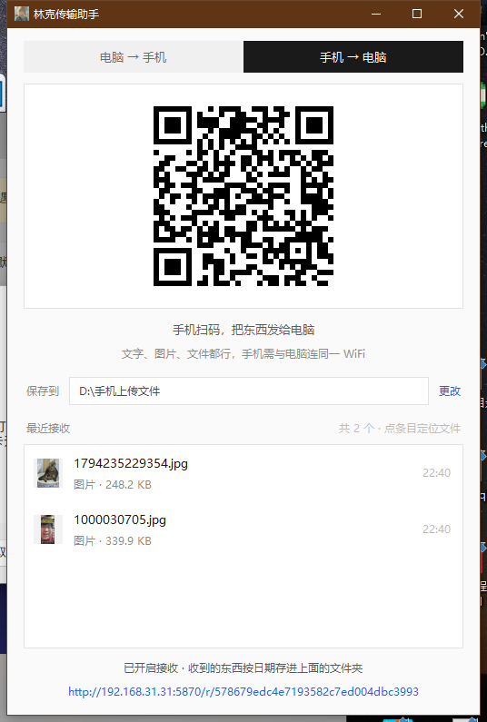
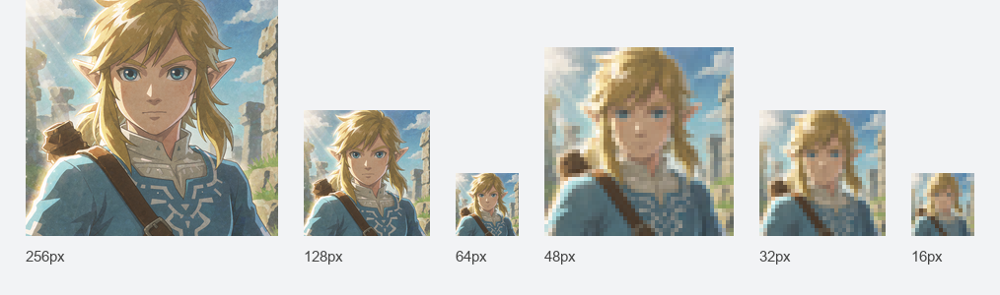

# 林克传输助手 · Link Transfer Assistant

[](https://github.com/)
[](https://www.python.org/)
[](LICENSE)
[](#快速开始)

**手机和电脑互传文件，扫个码就行** —— 免数据线、免装 App、不走云端服务器。

林克传输助手是一个 Windows 单文件小工具，把「手机 ↔ 电脑」之间的文件传输压缩成一次扫码：

- 电脑上生成二维码 → 手机扫一扫 → **取走文字、图片、文件**
- 手机扫码打开网页 → **把照片、视频、文档传回电脑**，自动存进你指定的文件夹

全程只走**局域网 Wi-Fi**，不经过任何服务器，不需要注册登录，也不上传到任何网盘。

> **English** — A single-file Windows utility for transferring text, images and files
> between a phone and a PC over local Wi-Fi via QR code. No app install, no USB cable,
> no cloud upload, no account. Scan the code, transfer, done.

**[⬇ 下载最新版](../../releases/latest)** · Windows 10 / 11 · 约 20 MB · 免安装

---

## 目录

- [解决什么问题](#解决什么问题)
- [功能](#功能)
- [截图](#截图)
- [快速开始](#快速开始)
- [使用方法](#使用方法)
- [工作原理](#工作原理)
- [安全设计](#安全设计)
- [从源码构建](#从源码构建)
- [项目结构](#项目结构)
- [常见问题](#常见问题)
- [已知限制](#已知限制)
- [免责声明](#免责声明)
- [许可](#许可)

---

## 解决什么问题

想把手机上一段长文字弄到电脑、把电脑上的 PDF 发到手机、把手机拍的照片存进电脑，
常规做法都有点麻烦：

| 做法 | 麻烦在哪 |
|---|---|
| 发到微信「文件传输助手」 | 得先打开微信、登录、找到会话，图片还会被压缩 |
| 插 USB 数据线 | 找线、选传输模式、安卓还要装驱动 |
| 网盘 / 云同步 | 要登录、要上传、要等同步，隐私内容还过了第三方服务器 |
| AirDrop | 只在苹果生态里能用，Windows 没有对应物 |
| 装一个传输 App | 手机电脑都得装，还得配对 |

这个工具的思路是：**两边已经在同一个 WiFi 里了，那就直接连，别再绕一圈。**

---

## 功能

### 电脑 → 手机

| 你给的 | 二维码里装的 | 手机扫码后 |
|---|---|---|
| 短文字（≤ 600 字节） | 文字本身 | 直接显示，可一键复制，**完全离线** |
| 长文字 | 局域网链接 | 网页显示全文 + 复制按钮 |
| 图片 | 局域网链接 | 显示原图，长按存相册，或点「下载原图」 |
| 其他文件 | 局域网链接 | 显示文件名和大小，点「下载到手机」 |

支持两种输入方式：**把文件拖进窗口**，或者 **Ctrl+V 直接粘贴**（会自动识别剪贴板里是
截图、复制的文件，还是纯文字）。

### 手机 → 电脑

扫码打开接收页，可以：

- 发文字 —— 收到后**自动进电脑剪贴板**，直接 Ctrl+V 就能用
- 发照片 —— 保留原始字节，不压缩、不转码
- 发任意文件 —— 包括 `.exe` `.zip` `.pdf` 等

收到的内容按日期存进 `保存路径\2026-11-09\`，重名文件自动加序号，不会覆盖。

### 其他细节

- **原文件只读不复制** —— 拖进来的文件不会被移动、改名或修改，程序只按路径读取
- **断点续传** —— 服务端支持 HTTP Range，手机下载中断可以接着下
- **多网卡可选** —— 有 VMware、Docker 虚拟网卡时，点窗口底部地址切换出口 IP
- **路径持久化** —— 保存路径设一次就记住，同一台电脑重开软件还是它
- **绿软** —— 单个 exe，不写注册表，不装服务，删掉就干净了

---

## 截图

**电脑 → 手机**（粘贴文字，或拖入图片 / 文件）



**手机 → 电脑**（扫码后手机发来的东西落在这里）



**应用图标** —— 从 16px 到 256px 都做了单独尺寸，任务栏、Alt+Tab、资源管理器各取所需



---

## 快速开始

### 方式一：直接下载（推荐）

到 **[Releases](../../releases/latest)** 选一个：

| 文件 | 说明 |
|---|---|
| `link-transfer-assistant-v1.0.0.zip` | 解压后是 `林克传输助手.exe` 和使用说明，**想保留中文文件名就下这个** |
| `link-transfer-assistant-v1.0.0.exe` | 直接双击运行，免解压（下载后可自行改名，不影响使用） |

双击打开，无需安装。

> 首次运行 Windows 会弹防火墙提示，点 **允许访问**，否则手机连不上电脑。

### 方式二：从源码运行

```bash
git clone <本仓库地址>
cd link-transfer-assistant
pip install qrcode pillow
python text2qr.py
```

---

## 使用方法

### 电脑 → 手机

1. 打开软件，默认停在「电脑 → 手机」
2. 把文字粘进输入框，或把图片 / 文件拖进窗口，或按 Ctrl+V 粘贴截图
3. 手机扫一扫二维码
4. 长文字、图片、文件需要**手机和电脑连同一个 WiFi**

### 手机 → 电脑

1. 点窗口顶部的「手机 → 电脑」
2. 手机扫二维码，打开接收页
3. 在网页上输入文字，或者选照片 / 文件上传
4. 电脑上会自动出现「最近接收」条目，点一下在资源管理器里定位

想换保存位置：点接收页的「更改」，选一个文件夹，之后一直生效。

> 切回「电脑 → 手机」不会中断接收，只有关掉软件才停。

---

## 工作原理

二维码的容量上限约 **2.9 KB**，一张照片动辄几 MB，所以图片和文件不可能塞进二维码。
程序的做法是：二维码里只放一个**局域网地址**，手机扫码后直连电脑上临时开的小型 HTTP 服务。

```
┌──────────┐   扫码拿到 http://192.168.x.x:端口/...    ┌──────────┐
│   手机    │ ────────────────────────────────────────▶ │   电脑    │
│ 浏览器    │ ◀──────────────────────────────────────── │ 内建服务  │
└──────────┘        同一 WiFi，直连，不过公网            └──────────┘
```

四条路由对应四种内容：

| 路由 | 作用 |
|---|---|
| `GET /t/<token>` | 文字页 |
| `GET /i/<token>` | 图片页（`?raw=1` 取原图，`?dl=1` 下载） |
| `GET /f/<token>` | 文件下载 |
| `GET /r/<token>` | 接收页（手机上传入口） |
| `POST /r/<token>/u?name=` | 上传文件原始字节（流式，64 KB 一块） |
| `POST /r/<token>/t` | 上传文字 |
| `GET /r/<token>/list` | 已接收清单 |

唯一例外是**短文本**：600 字节以内直接编码进二维码，手机离线也能读，这条路完全不启动服务。

---

## 安全设计

这类工具真正的风险不在实现难度，而在「谁能往你的磁盘写东西」。这里做了几条硬性约束：

- **只写不读** —— 接收模式下服务端**没有任何读取接口**。拿到链接的人可以往里写，
  但取不走你电脑上的任何文件
- **token 每次启动重新生成** —— 32 位随机，程序重启后旧链接立即失效
- **文件名净化** —— 取 basename、剔除 `\ / : * ? " < > |`、拦截 `CON` `NUL` `COM1`
  等 Windows 保留名、限制 120 字符，`../../逃逸.txt` 会落成 `逃逸.txt`
- **写入位置由桌面端持有** —— 客户端传不了任何目录信息，天然免疫目录穿越
- **上限与余量检查** —— 单文件 2 GB 上限，写入前检查磁盘剩余空间
- **并发限制** —— 最多 3 个上传同时进行，避免被打满
- **不联网** —— 不包含任何遥测、统计、自动更新请求

需要提醒的是：**同一个 WiFi 下拿到链接的人可以往你的文件夹写东西**。
在公共 WiFi（咖啡厅、酒店）里用接收功能请谨慎，用完直接关掉软件即可。

---

## 从源码构建

需要 Python 3.12（带 tkinter）：

```bash
pip install qrcode pillow pyinstaller
python gen_icon.py            # 由 assets/link-master.png 生成 link.ico
python -m PyInstaller --noconfirm --onefile --windowed ^
  --icon link.ico --add-data "link.ico;." ^
  --exclude-module numpy --exclude-module pytest --exclude-module setuptools ^
  --name "林克传输助手" text2qr.py
```

产物在 `dist/林克传输助手.exe`，约 20 MB。

`--exclude-module numpy` 不是可选项：Pillow 会连带把 numpy 拉进来，不排除的话
exe 会从 19.5 MB 涨到 31 MB。

自检（12 组检查，覆盖短文本、长文本、图片、文件、上传、净化、重名、大小限制等）：

```bash
python selftest.py
```

---

## 项目结构

```
text2qr.py       主程序：窗口、界面状态、二维码生成、内容分发
share_server.py  局域网 HTTP 服务：四条发送路由 + 三条接收路由
dragdrop.py      原生文件拖放（ctypes 调 WM_DROPFILES，零第三方依赖）
config.py        配置持久化（%APPDATA%\林克传输助手\config.json）
gen_icon.py      由母版图生成多尺寸 ico
selftest.py      端到端自检
assets/          图标母版
docs/            文档截图
```

只依赖 `qrcode` 和 `Pillow` 两个库，拖放和服务端都是标准库实现。

---

## 常见问题

**Q：手机传文件到电脑，一定要连数据线吗？**
不用。只要手机和电脑连在同一个 WiFi 下，扫码就能传，全程无线。

**Q：iPhone 能把照片传到 Windows 电脑吗？**
可以。iPhone 微信扫码打开接收页，选照片上传即可，照片保留原始字节不压缩。
如果微信内置浏览器传大视频失败，点右上角「在浏览器打开」再传。

**Q：安卓手机怎么把文件传到电脑？**
同上，扫码打开网页选文件上传。不挑品牌，也不需要装任何 App。

**Q：和微信「文件传输助手」有什么区别？**
不用登录、不用加好友、图片不压缩、文件不过腾讯服务器，而且**两个方向都能走**。
缺点是必须在同一个 WiFi 下，跨网络用不了。

**Q：需要联网吗？**
局域网内互相通信即可，**不需要外网**。短文字甚至不需要开服务，纯离线可读。

**Q：二维码最多能装多少内容？**
约 2.9 KB，所以短文本（600 字节内）直接编码，超出的自动改走局域网链接。

**Q：能传多大的文件？**
单文件上限 2 GB，采用流式写入，传 1 GB 的文件也不会把内存吃满。

**Q：文件会上传到云端吗？**
不会。程序不包含任何上传逻辑，也没有服务器地址可配，数据只在两台设备之间流动。

**Q：换一台电脑还能用吗？**
能。exe 拷过去直接运行，配置和临时目录都会自动指向新机器。

**Q：关掉软件后，之前的链接还能用吗？**
不能。链接随程序启动而生成、随程序关闭而失效，这是有意的设计。

---

## 已知限制

- 只支持 **Windows**（依赖 Windows 的拖放 API 与图标格式）
- 必须处于**同一个局域网**，无法跨网络或跨 NAT 传输
- 微信内置浏览器对超大文件和长连接不稳定，建议改用系统浏览器
- 手机端「保存到相册」依赖长按图片，无法自动写入相册（微信限制了网页的这个能力）
- PDF、Office 文档、压缩包在手机上只能看到清单和下载按钮，无法预览
- 一次只能处理一个条目，拖入多个文件时只取第一个

---

## 免责声明

本项目图标为**同人创作**，角色形象版权归任天堂（Nintendo）所有，
与任天堂无任何关联，也未获其授权或认可。图标仅用于个人非商业用途，
**不在下方 MIT 许可范围内**。若需商用或公开发布衍生作品，请自行替换图标。

代码部分可自由使用、修改、分发，见下节。

---

## 许可

[MIT](LICENSE) © 2026 Link Transfer Assistant contributors

代码采用 MIT 许可；`assets/` 与 `link.ico` 中的角色形象除外。
